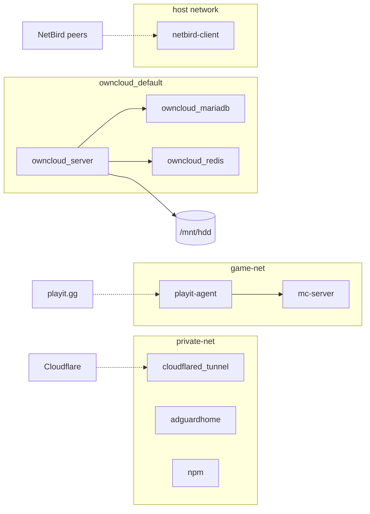

# 🏠 server-compose

Koleksi Docker Compose stack untuk home server pribadi (Dell OptiPlex 3060, Ubuntu Server). Setiap service punya folder dan compose file sendiri, dan network-nya dipisah sesuai kebutuhan. Lihat [Arsitektur Network](#-arsitektur-network). (**BERDASARKAN PENGALAMAN**)

---

## 📋 Daftar Service

| Service | Deskripsi | Port |
|---|---|---|
| [AdGuard Home](#%EF%B8%8F-adguard-home) | DNS-level ad blocker & tracker blocker | `53`, `3000`, `8080` |
| [Nginx Proxy Manager](#-nginx-proxy-manager-npm) | Reverse proxy + SSL otomatis | `80`, `443`, `81` |
| [Cloudflared](#%EF%B8%8F-cloudflared-tunnel) | Cloudflare Tunnel — expose service ke internet tanpa buka port router | — |
| [NetBird Client](#-netbird-client) | VPN mesh network peer-to-peer | — |
| [ownCloud](#%EF%B8%8F-owncloud) | Self-hosted cloud storage + file sharing | `8081` (atur lewat `HTTP_PORT`) |
| [Minecraft Server](#-minecraft-server) | Paper MC server dengan voice chat & crack support | `25565`, `18432/udp`, `19132/udp` |
| [Playit Agent](#-playit-agent) | Tunnel Minecraft ke internet via playit.gg | — |

---

## ⚡ Prasyarat

Pastikan sudah terinstall sebelum mulai:

- [Docker Engine](https://docs.docker.com/engine/install/) (v24+)
- [Docker Compose](https://docs.docker.com/compose/install/) (v2+)

---

## 🌐 Arsitektur Network

Tidak semua container berada di satu network. Pembagiannya:

| Network | Tipe | Container |
|---|---|---|
| `private-net` | external, dibuat manual | `adguardhome`, `npm`, `cloudflared_tunnel` |
| `game-net` | external, dibuat manual | `mc-server`, `playit-agent` |
| `owncloud_default` | dibuat otomatis oleh Compose | `owncloud_server`, `owncloud_mariadb`, `owncloud_redis` |
| host (`network_mode: host`) | network milik host | `netbird-client` |



Garis putus-putus = koneksi yang diatur di dashboard masing-masing layanan, bukan di compose file.

> **Catatan:** network terpisah bukan berarti terisolasi penuh. Port yang di-publish ke host (`ports:`) tetap bisa diakses dari LAN lewat IP server.

### Buat network external

Buat dua network ini sebelum menjalankan stack manapun. `owncloud_default` tidak perlu dibuat karena Compose membuatnya otomatis.

```bash
# Service utama (adguardhome, npm, cloudflared)
docker network create private-net

# Game server (minecraft + playit)
docker network create game-net
```

---

## 🚀 Cara Menjalankan

Clone repo ini ke server kamu:

```bash
git clone https://github.com/KoroyaNara/server-compose.git
cd server-compose
```

Masuk ke folder service yang ingin dijalankan. Kalau ada file `.env.example`, salin dulu jadi `.env` lalu isi nilainya:

```bash
cp .env.example .env
nano .env
docker compose up -d
```

> File `.env` berisi token dan password, jadi sudah masuk `.gitignore` dan tidak ikut ter-commit.

---

## 📦 Detail Service

### 🛡️ AdGuard Home

DNS server lokal yang memblokir iklan dan tracker di seluruh jaringan rumah.

**Setup:**

```bash
cd adguardhome
docker compose up -d
```

**Akses:** `http://<IP-SERVER>:3000` (setup wizard pertama kali), lalu `http://<IP-SERVER>:8080`

> Arahkan DNS router kamu ke IP server agar semua device di jaringan terproteksi secara otomatis.

---

### 🔁 Nginx Proxy Manager (NPM)

Reverse proxy dengan UI yang mudah digunakan. Bisa generate SSL certificate otomatis via Let's Encrypt.

**Setup:**

```bash
cd npm
docker compose up -d
```

**Akses:** `http://<IP-SERVER>:81`

**Kredensial default:**
- Email: `admin@example.com`
- Password: `changeme`

> Ganti kredensial default segera setelah login pertama.

---

## 🌍 Setup Domain & SSL

Setelah AdGuard Home dan NPM berjalan, lanjutkan ke setup domain agar semua service bisa diakses lewat subdomain yang rapi dengan HTTPS.

### 1. Daftarkan Domain ke Cloudflare

1. Login ke [Cloudflare Dashboard](https://dash.cloudflare.com/) → **Add a Site** → masukkan domain kamu
2. Cloudflare akan memberikan **2 nameserver**, contoh:
   ```
   anya.ns.cloudflare.com
   brad.ns.cloudflare.com
   ```
3. Buka panel registrar domain kamu → ganti nameserver lama dengan 2 nameserver dari Cloudflare
4. Tunggu propagasi — biasanya 5–30 menit, maksimal 24 jam. Cloudflare akan kirim email konfirmasi ketika domain sudah aktif

---

### 2. Arahkan Domain ke Home Server via AdGuard DNS Rewrite

Kuncinya ada di sini: home server dijadikan DNS server jaringan rumah lewat AdGuard, sehingga semua subdomain bisa diarahkan langsung ke IP server lokal — tanpa perlu buka port ke internet.

**Langkah 1 — Ubah primary DNS router ke IP server:**

Masuk ke setting router Wi-Fi → cari pengaturan **DNS Server** → ubah **Primary DNS** ke IP server kamu (contoh: `192.168.1.100`).

**Langkah 2 — Tambah DNS Rewrite di AdGuard Home:**

1. Buka dashboard AdGuard Home → menu **Filters** → **DNS Rewrites**
2. Klik **Add DNS Rewrite**, tambahkan dua entri:

   | Domain | IP |
   |---|---|
   | `domain.kamu.com` | `192.168.1.100` |
   | `*.domain.kamu.com` | `192.168.1.100` |

Sekarang semua request ke `*.domain.kamu.com` dari jaringan rumah akan langsung diarahkan ke server, dan NPM yang akan meneruskan ke masing-masing aplikasi.

---

### 3. Generate Wildcard SSL Certificate di NPM

Menggunakan **Cloudflare DNS Challenge** agar bisa dapat satu sertifikat SSL untuk semua subdomain sekaligus.

**Langkah 1 — Buat Cloudflare API Token:**

1. Buka [Cloudflare Dashboard](https://dash.cloudflare.com/) → **Profile** → **API Tokens** → **Create Token**
2. Pilih template **Edit zone DNS** → di bagian **Zone Resources** pilih domain kamu
3. Klik **Continue to summary** → **Create Token** → **salin token** (hanya tampil sekali)

**Langkah 2 — Tambah SSL Certificate di NPM:**

1. Buka NPM dashboard → menu **SSL Certificates** → **Add SSL Certificate**
2. Isi domain:
   ```
   domain.kamu.com
   *.domain.kamu.com
   ```
3. Aktifkan **Use a DNS Challenge** → pilih provider **Cloudflare**
4. Paste token Cloudflare yang tadi disalin
5. Klik **Save** — NPM akan otomatis request sertifikat wildcard ke Let's Encrypt

---

### 4. Tambah Proxy Host di NPM

Buat proxy host untuk setiap service — mulai dari AdGuard Home dan NPM itu sendiri.

1. Buka NPM dashboard → **Proxy Hosts** → **Add Proxy Host**
2. Isi konfigurasi:

   | Field | AdGuard Home | NPM |
   |---|---|---|
   | **Domain Names** | `adguard.domain.kamu.com` | `npm.domain.kamu.com` |
   | **Forward Hostname/IP** | `adguardhome` (nama container) | `npm` |
   | **Forward Port** | `3000` | `81` |
   | **Block Common Exploits** | ✅ | ✅ |

3. Tab **SSL** → pilih sertifikat wildcard yang tadi dibuat → aktifkan **Force SSL**
4. Klik **Save**

> Nama container bisa dipakai sebagai hostname karena AdGuard Home dan NPM sama-sama berada di `private-net`, sehingga Docker bisa resolve nama container langsung.
>
> ownCloud **tidak** berada di `private-net`, jadi untuk proxy host ownCloud isi **Forward Hostname/IP** dengan IP server (contoh `192.168.1.100`) dan **Forward Port** dengan nilai `HTTP_PORT` (default `8081`).

---

### 5. Tutup Port Admin UI (Hardening)

Setelah bisa diakses lewat subdomain, port admin UI tidak perlu terbuka lagi ke jaringan. Comment port yang tidak diperlukan di masing-masing compose file:

**`adguardhome/docker-compose.yml`** — comment port setup wizard dan admin UI:

```yaml
ports:
  - "53:53/tcp"
  - "53:53/udp"
  # - "3000:3000/tcp"   # Setup wizard — matikan setelah setup selesai
  # - "8080:80/tcp"     # Admin UI — akses lewat subdomain saja
```

**`npm/docker-compose.yml`** — comment port admin UI:

```yaml
ports:
  - '80:80/tcp'
  - '443:443/tcp'
  # - '81:81/tcp'       # Admin UI — akses lewat subdomain saja
```

Setelah diedit, recreate container tanpa down:

```bash
# AdGuard
cd adguardhome && docker compose up -d

# NPM
cd ../npm && docker compose up -d
```

Docker akan otomatis recreate container dengan konfigurasi port yang baru.

---

### ☁️ Cloudflared Tunnel

Expose service ke internet tanpa perlu buka port di router (zero trust tunnel via Cloudflare).

**Setup:**

1. Buat tunnel di [Cloudflare Zero Trust Dashboard](https://one.dash.cloudflare.com/)
2. Salin token tunnel, lalu buat file `.env` dari contoh:

```bash
cd cloudflared
cp .env.example .env   # isi TUNNEL_TOKEN
```

3. Jalankan:

```bash
cd cloudflared
docker compose up -d
```

---

### 🔒 NetBird Client

Koneksi VPN mesh antar device/server secara peer-to-peer menggunakan WireGuard di balik layar.

**Setup:**

1. Daftar di [NetBird](https://netbird.io/) dan buat Setup Key baru
2. Buat file `.env` dari contoh:

```bash
cd netbird-client
cp .env.example .env   # isi NB_SETUP_KEY
```

3. Jalankan:

```bash
cd netbird-client
docker compose up -d
```

---

### 🔒 Setup NetBird Network Route

Setelah container NetBird berjalan, lakukan konfigurasi berikut di [NetBird Dashboard](https://app.netbird.io/) agar semua device yang terkoneksi ke NetBird bisa mengakses seluruh jaringan rumah — bukan hanya server itu sendiri.

#### Network Route — Expose LAN ke Semua Peer

1. Buka **Network Routes** → **Add Route**
2. Isi konfigurasi:

   | Field | Value |
   |---|---|
   | **Network Range** | `192.168.1.0/24` (sesuaikan dengan subnet LAN kamu) |
   | **Name** | `Home LAN Kamu` |
   | **Routing Peer** | `server-kamu` |
   | **Masquerade** | ✅ Aktifkan |

3. Tab **Settings** → pastikan **Enable Route** dan **Masquerade** keduanya aktif
4. Klik **Save Changes**

> **Masquerade** wajib diaktifkan agar device lain di LAN tidak perlu tahu soal NetBird — traffic dari peer akan di-NAT lewat server, sehingga reply packet bisa balik dengan benar.

#### DNS Nameserver — Arahkan DNS ke AdGuard

Agar peer yang connect via NetBird juga ikut menggunakan AdGuard Home sebagai DNS (dapat ad-blocking + bisa resolve subdomain lokal):

1. Buka **DNS** → **Nameservers** → **Add Nameserver**
2. Isi konfigurasi:

   | Field | Value |
   |---|---|
   | **Name** | `DNS Kamu` |
   | **IP** | `192.168.1.100` (IP server di LAN) |
   | **Port** | `53` |
   | **Distribution Groups** | `All` |

3. Aktifkan **Enable Nameserver** → **Save Changes**

Sekarang siapapun yang connect ke NetBird dari luar rumah akan otomatis bisa mengakses semua device di LAN dan memakai AdGuard sebagai DNS.

---

### 🗂️ ownCloud

Self-hosted cloud storage. Data file disimpan di HDD eksternal (`/mnt/hdd`), dengan backup folder Minecraft yang di-mount sekalian.

**Setup:**

1. Pastikan HDD sudah di-mount ke `/mnt/hdd` di server
2. Buat file `.env` dari contoh, lalu isi semua nilainya (termasuk `DB_PASSWORD` dan `DB_ROOT_PASSWORD`):

```bash
cd owncloud
cp .env.example .env
```

3. Jalankan:

```bash
docker compose up -d
```

**Akses:** `http://<IP-SERVER>:8081`

> Stack ini menjalankan tiga container sekaligus: ownCloud, MariaDB, dan Redis. Ketiganya berada di network `owncloud_default` yang dibuat otomatis oleh Compose, dan MariaDB serta Redis tidak membuka port ke host.

> **Port:** default `HTTP_PORT` adalah `8081` karena `8080` sudah dipakai admin UI AdGuard Home. Kalau port `8080` AdGuard sudah kamu tutup (lihat bagian Hardening), ownCloud boleh memakai `8080`.

> **Password database:** `DB_PASSWORD` dan `DB_ROOT_PASSWORD` hanya dipakai saat MariaDB pertama kali dibuat. Kalau database sudah ada, isi `.env` dengan password yang lama. Mengganti nilainya di `.env` saja tidak mengubah password di dalam MariaDB.

---

### 🎮 Minecraft Server

Paper MC server versi 1.21.8 dengan konfigurasi untuk server crack (offline mode) + whitelist.

**Spesifikasi:**
- Type: PaperMC
- RAM: 6 GB
- Mode: Offline (crack support)
- Whitelist: Aktif
- Port suara (Simple Voice Chat): `18432/udp`
- Port Bedrock/Geyser: `19132/udp`

**Setup:**

```bash
cd minecraft
docker compose up -d
```

**Manajemen server via console:**

```bash
docker exec -it mc-server rcon-cli
```

Ini membuka RCON shell interaktif langsung ke server. Ketik `exit` untuk keluar tanpa mematikan server.

**Plugin yang dipakai:**

| Plugin | Fungsi |
|---|---|
| `AuthMe-5.6.0.jar` | Login/register password — wajib untuk server crack/offline mode |
| `Geyser-Spigot.jar` | Jembatan Bedrock ↔ Java — player Bedrock (HP/Console) bisa join |
| `floodgate-spigot.jar` | Companion Geyser — bypass auth untuk player Bedrock |
| `ViaVersion-5.6.0.jar` | Player dengan versi MC berbeda bisa join server yang sama |
| `voicechat-bukkit-2.6.7.jar` | Proximity voice chat in-game |
| `FastLeafDecay-Fabric-36.jar` | Daun pohon decay lebih cepat setelah ditebang |
| `RHLeafDecay-1.21_R1.jar` | Alternatif/pelengkap fast leaf decay untuk 1.21 |

> Untuk tambah plugin, letakkan file `.jar` di `minecraft/plugins/` lalu restart container.

**Command server penting (jalankan via `rcon-cli`):**

```bash
# Jadikan player sebagai OP (admin)
op NamaPlayer

# Cabut OP
deop NamaPlayer

# Tambah player ke whitelist
whitelist add NamaPlayer

# Hapus player dari whitelist
whitelist remove NamaPlayer

# Reload whitelist (setelah edit file whitelist.json manual)
whitelist reload

# Lihat daftar whitelist
whitelist list

# Kick player
kick NamaPlayer AlasanKick

# Ban player
ban NamaPlayer AlasanBan

# Lihat player yang sedang online
list

# Stop server dengan aman
stop
```

---

### 🎯 Playit Agent

Tunnel Minecraft ke internet via [playit.gg](https://playit.gg) — cocok jika tidak bisa buka port di router.

**Setup:**

1. Daftar di playit.gg dan buat agent baru
2. Buat file `.env` dari contoh lalu isi secret key agent:

```bash
cd playit
cp .env.example .env   # isi SECRET_KEY
```

3. Jalankan:

```bash
docker compose up -d
```

> `playit-agent` wajib berada di network yang sama dengan `mc-server` (`game-net`), supaya agent bisa menjangkau server Minecraft lewat nama container.

---

## 🗂️ Struktur Folder

```
server-compose/
├── .gitignore
├── adguardhome/
│   └── docker-compose.yml
├── cloudflared/
│   ├── docker-compose.yml
│   └── .env.example          # TUNNEL_TOKEN
├── minecraft/
│   └── docker-compose.yml
├── netbird-client/
│   ├── docker-compose.yml
│   └── .env.example          # NB_SETUP_KEY
├── npm/
│   └── docker-compose.yml
├── owncloud/
│   ├── docker-compose.yml
│   └── .env.example          # Konfigurasi ownCloud + password DB
└── playit/
    ├── docker-compose.yml
    └── .env.example          # SECRET_KEY
```

File `.env` asli dibuat sendiri di server dari `.env.example` dan tidak ikut di-commit.

---

## 🔐 Catatan Keamanan

- Semua token dan password disimpan di `.env` yang tidak di-commit. Jangan menulis secret langsung di `docker-compose.yml`.
- Ganti semua password dan secret key default sebelum dipakai.
- Gunakan NPM untuk SSL termination agar traffic ke service dienkripsi.
- Cloudflare Tunnel dan NetBird dipakai untuk akses remote tanpa membuka port di router.
- Pemisahan Docker network membatasi container mana yang bisa saling memanggil, tapi **bukan** firewall. Port yang di-publish ke host tetap terbuka di LAN, jadi tutup port yang tidak perlu (lihat bagian Hardening).
- `netbird-client` berjalan dengan `privileged: true` dan host network, jadi container ini punya akses luas ke host.

---

## 🛠️ Perintah Berguna

```bash
# Lihat semua container yang berjalan
docker ps

# Lihat log service tertentu
docker compose logs -f

# Stop semua container di satu stack
docker compose down

# Update image ke versi terbaru
docker compose pull && docker compose up -d

# Lihat penggunaan resource
docker stats
```
